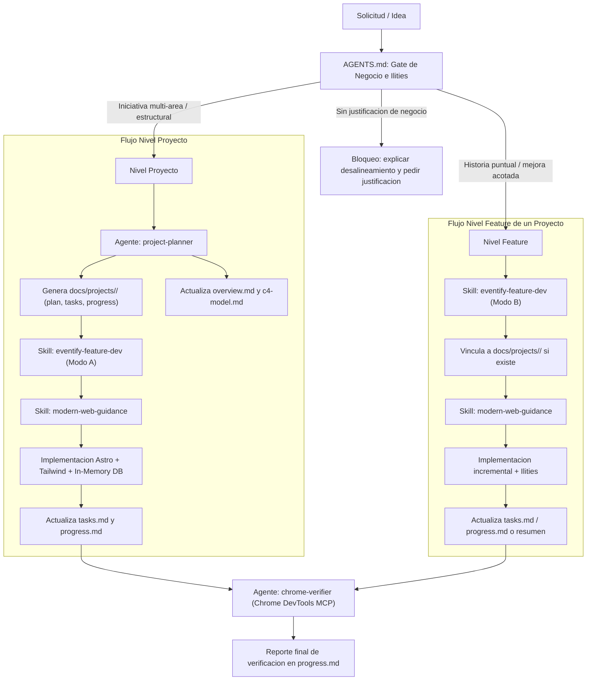

# Eventify — Demo de Arquitectura Frontend con Agent Harness

Repositorio demo de **arquitectura frontend guiada por agentes** para **Eventify**, mostrando cómo alinear estrategia de negocio, atributos de calidad (*ilities*), documentación viva (**C4 Model**), estándares web modernos y verificación en navegador real tanto a **nivel proyecto** como a **nivel feature**.

---

## 1. Contexto de Negocio (Eventify)

- **Misión:** Conectar usuarios con eventos y brindar experiencias únicas tanto presencial como remota.
- **Visión:** Convertirnos en la plataforma de eventos número 1 de LATAM.
- **Áreas de la empresa:** Marketing, Contabilidad, Ops y Desarrollo.
- **Atributos de Calidad (*Ilities*):**
  - **Security:** Validación en fronteras HTTP/formularios, prevención de XSS y cabeceras seguras.
  - **Usability:** HTML5 semántico, accesibilidad WCAG 2.1 AA, rendimiento (CWV) y claridad entre eventos presenciales, remotos e híbridos.
  - **Portability:** Estándares web nativos y repositorios desacoplados (`src/domain/`) para migrar la base de datos en memoria sin reescribir la UI.
- **Stack:** Astro (SSR con `@astrojs/node`), Tailwind CSS v4, TypeScript estricto, In-Memory Database y `pnpm`.

---

## 2. Estructura del Monorepo y del Harness

Este repositorio está estructurado como **monorepo (`pnpm workspaces`)** para que una sola capa de gobernanza (`.agents/`, `AGENTS.md` y `docs/`) gobierne múltiples proyectos de Eventify (`apps/*` y `packages/*`):

```text
.
├── pnpm-workspace.yaml        # Workspaces: apps/* y packages/*
├── AGENTS.md                  # Gobernanza global y Gate de Negocio
├── .agents/                   # Agentes (project-planner, chrome-verifier) y skills
├── docs/                      # Arquitectura viva, C4 Model y docs/projects/<slug>/
├── apps/
│   └── web/                   # @eventify/web (Astro + Tailwind v4 + In-Memory DB)
└── packages/                  # Paquetes compartidos entre proyectos
```

| Pieza | Ubicación | Propósito |
| :--- | :--- | :--- |
| **Rules de Negocio** | [AGENTS.md](./AGENTS.md) | Define Misión, Visión, Áreas, *Ilities* y el **Gate de Negocio** para evitar trabajo sin justificación. |
| **Agente Planificador** | [.agents/agents/project-planner.md](./.agents/agents/project-planner.md) | Evalúa negocio, esfuerzo, tiempo y áreas; genera `plan.md`, `tasks.md`, `progress.md` y actualiza diagramas + **C4 Model**. |
| **Skill de Desarrollo** | [.agents/skills/eventify-feature-dev/SKILL.md](./.agents/skills/eventify-feature-dev/SKILL.md) | Guía la implementación a **nivel proyecto** o **nivel feature**, integrando `modern-web-guidance` y actualizando `tasks.md` y `progress.md`. |
| **Agente Verificador** | [.agents/agents/chrome-verifier.md](./.agents/agents/chrome-verifier.md) | Audita la app en navegador real usando **Chrome DevTools MCP** y registra hallazgos en `progress.md`. |
| **Arquitectura Viva y C4** | [docs/architecture/overview.md](./docs/architecture/overview.md) · [c4-model.md](./docs/architecture/c4-model.md) | Diagramas Mermaid de capas y **C4 Model** (Contexto, Contenedores, Componentes y Código). |
| **Plantillas de Proyecto** | [docs/projects/_template/](./docs/projects/_template/) | Estructura estándar (`plan.md`, `tasks.md`, `progress.md`) para nuevos proyectos. |

---

## 3. Flujo de Trabajo: Nivel Proyecto vs Nivel Feature



---

## 4. Cómo Usar el Harness Paso a Paso

### Escenario 0: Probar el Gate de Negocio (trabajo no justificado)
Las rules en [AGENTS.md](./AGENTS.md) están siempre activas. Si pides algo sin alineamiento con la Misión/Visión ni valor para Marketing, Contabilidad, Ops o Desarrollo:
> *"Agrega un minijuego de Tetris en el footer de Eventify."*

El agente debe **detenerse**, señalar qué criterio del Gate falla y pedir justificación o proponer una alternativa alineada.

---

### Escenario 1: Trabajar a Nivel Proyecto (Ciclo Completo)

1. **Planificar con `project-planner`:**
   > *"Usa el agente `project-planner` para planificar un sistema de registro de asistentes a eventos con control de cupos y resumen de ingresos."*
   - Valida el Gate de Negocio.
   - Analiza impacto en **Marketing**, **Contabilidad**, **Ops** y **Desarrollo**.
   - Estima esfuerzo (tallas/horas) y tiempo (fases).
   - Crea `docs/projects/<slug>/plan.md`, `tasks.md` y `progress.md`.
   - Actualiza [overview.md](./docs/architecture/overview.md) y [c4-model.md](./docs/architecture/c4-model.md).

2. **Desarrollar con `eventify-feature-dev` (Modo A):**
   > *"Inicia el desarrollo del proyecto en `docs/projects/<slug>/` usando el skill `eventify-feature-dev`."*
   - Lee `plan.md`, `tasks.md` y `progress.md`.
   - Consulta **`modern-web-guidance`** antes de escribir HTML/CSS/JS cliente.
   - Implementa la tarea respetando `src/domain/` (*Portability*), validaciones (*Security*) y accesibilidad (*Usability*).
   - Ejecuta `pnpm check` y `pnpm build`.
   - Marca tareas completadas en `tasks.md` y registra el avance en `progress.md`.

3. **Verificar con `chrome-verifier`:**
   > *"Usa `chrome-verifier` para verificar los cambios del proyecto `<slug>` en `http://localhost:4321`."*
   - Abre la app en navegador real mediante **Chrome DevTools MCP**.
   - Valida criterios de aceptación, accesibilidad, consola, red y vistas desktop/mobile.
   - Registra el reporte final (**APROBADO / CON OBSERVACIONES**) en `progress.md`.

---

### Escenario 2: Trabajar a Nivel Feature de un Proyecto

Ideal cuando ya existe un proyecto (o la app base) y necesitas construir una **feature puntual** sin re-planificar todo el proyecto:

1. **Desarrollar la feature con `eventify-feature-dev` (Modo B):**
   - **Feature perteneciente a un proyecto planificado:**
     > *"Usa `eventify-feature-dev` para implementar únicamente la tarea `T-02` (modal accesible de registro con `<dialog>`) del proyecto `docs/projects/<slug>/`."*
   - **Feature incremental acotada sobre la app actual:**
     > *"Usa `eventify-feature-dev` en modo feature para agregar un buscador accesible por ciudad o título en el catálogo de eventos para mejorar descubrimiento (Marketing)."*
   - En ambos casos el skill:
     - Verifica el Gate de Negocio en `AGENTS.md`.
     - Consulta **`modern-web-guidance`** antes de escribir UI/CSS/JS.
     - Protege Security, Usability y Portability.
     - Actualiza `tasks.md` y `progress.md` si la feature pertenece a un proyecto.

2. **Verificar la feature con `chrome-verifier`:**
   > *"Usa `chrome-verifier` para auditar la nueva feature en `http://localhost:4321`."*

---

## 5. Desarrollo Local (`pnpm`)

```bash
# Instalar dependencias
pnpm install

# Levantar servidor de desarrollo (http://localhost:4321)
pnpm dev

# Verificar tipos y componentes Astro
pnpm check

# Compilar build de producción SSR
pnpm build
```

### Rutas iniciales
- `GET /` — Catálogo inicial de eventos presenciales, remotos e híbridos.
- `GET /api/events` — API JSON sobre la In-Memory Database (acepta `?modality=presencial|remoto|hibrido`).
