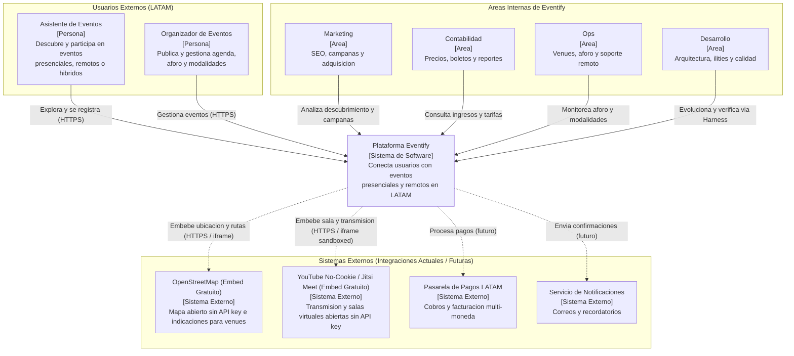
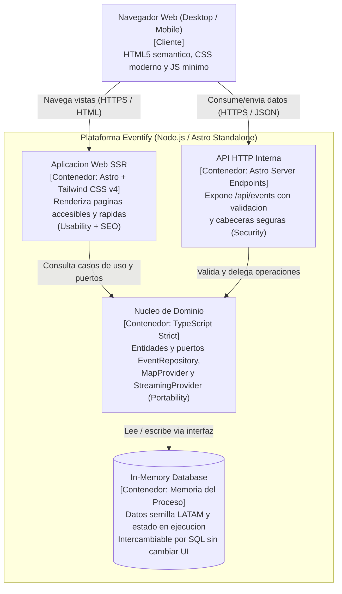
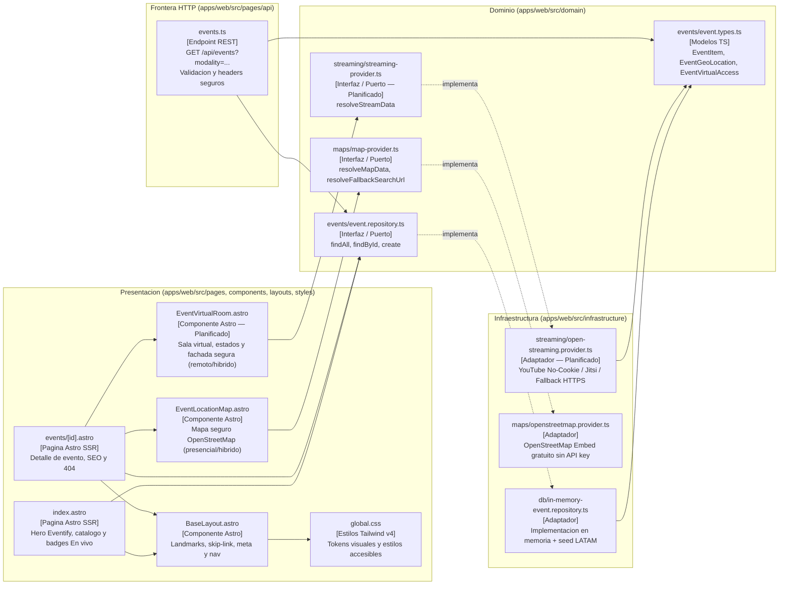

# C4 Model — Eventify

Este documento modela la arquitectura de **Eventify** utilizando el enfoque **C4 Model** (Contexto, Contenedores, Componentes y Código). Es un artefacto vivo: cuando `project-planner` diseña una nueva iniciativa que añade actores, servicios o módulos, debe actualizar el nivel correspondiente aquí.

---

## Nivel 1: Diagrama de Contexto del Sistema (System Context)

Muestra cómo los usuarios externos y las 4 áreas internas de **Eventify** interactúan con la plataforma, así como las fronteras con sistemas externos del ecosistema de eventos presenciales y remotos en LATAM.

---

## Nivel 2: Diagrama de Contenedores (Containers)

Detalla los bloques ejecutables y de almacenamiento dentro de la **Plataforma Eventify**, destacando cómo la aplicación SSR de Astro y los contratos de dominio permiten mantener **Portability**, **Security** y **Usability**.

---

## Nivel 3: Diagrama de Componentes (Components — `apps/web`)

Desglosa los componentes internos actuales y planificados de la aplicación pública `@eventify/web` (`apps/web/`) dentro del monorepo.

---

## Nivel 4: Código (Referencia Viva)

En lugar de duplicar diagramas de clases que quedan obsoletos rápidamente, el nivel 4 se referencia directamente al código fuente tipado en TypeScript estricto dentro del monorepo:
- **Contratos de Dominio:** `apps/web/src/domain/events/event.types.ts`, `apps/web/src/domain/events/event.repository.ts`, `apps/web/src/domain/maps/map-provider.ts` y *(planificado)* `apps/web/src/domain/streaming/streaming-provider.ts`
- **Implementación In-Memory y Adaptadores:** `apps/web/src/infrastructure/db/in-memory-event.repository.ts`, `apps/web/src/infrastructure/maps/openstreetmap.provider.ts` y *(planificado)* `apps/web/src/infrastructure/streaming/open-streaming.provider.ts`
- **Presentación y Frontera HTTP:** `apps/web/src/pages/index.astro`, `apps/web/src/pages/events/[id].astro`, `apps/web/src/components/EventLocationMap.astro`, *(planificado)* `apps/web/src/components/EventVirtualRoom.astro` y `apps/web/src/pages/api/events.ts`
