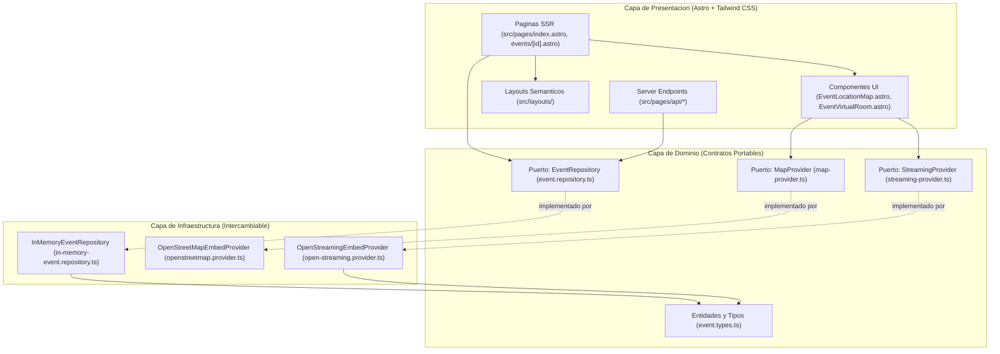

# Arquitectura de Eventify — Vista General

Este documento es la referencia viva de la arquitectura frontend y de dominio de **Eventify**. Debe mantenerse actualizado por el agente `project-planner` cada vez que un proyecto introduzca nuevos flujos, componentes o integraciones.

Para el desglose formal por niveles (Contexto, Contenedores y Componentes), consulta el [C4 Model de Eventify](./c4-model.md).

---

## 1. Estrategia de Negocio y Áreas

- **Misión:** Conectar usuarios con eventos y brindar experiencias únicas tanto presencial como remota.
- **Visión:** Convertirnos en la plataforma de eventos número 1 de LATAM.

| Área | Enfoque Principal en Eventify | Ejemplos de Iniciativas Alineadas |
| :--- | :--- | :--- |
| **Marketing** | Descubrimiento, SEO, conversión y alcance en LATAM | Landing de eventos, filtros por ciudad/modalidad, metadatos Open Graph, campañas |
| **Contabilidad** | Ingresos, precios, monedas LATAM, control de boletos | Resumen de precios/monedas, reportes de ventas, conciliación de registros |
| **Ops** | Logística presencial/remota, aforo, check-in, soporte | Control de cupos, enlaces de streaming, información de venue, estados del evento |
| **Desarrollo** | Arquitectura, *ilities*, DX, automatización y calidad | Harness de agentes, estándares web modernos, pruebas en navegador, portabilidad de datos |

---

## 2. Arquitectura en Capas (Orientada a *Portability*)

La interfaz web y los endpoints de Astro nunca acceden directamente a la implementación concreta de almacenamiento ni a SDKs propietarios de terceros. Toda interacción pasa por contratos en `src/domain/` (`EventRepository`, `MapProvider`, `StreamingProvider`), permitiendo reemplazar la **In-Memory Database** por PostgreSQL/LibSQL, intercambiar el proveedor de mapas (por defecto **OpenStreetMap** gratuito y sin API key) o cambiar el proveedor de streaming (por defecto **YouTube No-Cookie / Jitsi Meet** gratuito y sin API key) sin tocar las vistas.

---

## 3. Matriz de *Ilities* (Atributos de Calidad)

| Atributo (*Ility*) | Objetivo en Eventify | Decisiones Arquitectónicas | Cómo se Verifica |
| :--- | :--- | :--- | :--- |
| **Security** | Proteger usuarios, organizadores y datos de eventos | Validación estricta en APIs y dominio, allowlist HTTPS en `MapProvider`/`StreamingProvider`, `<iframe>` con `sandbox` y `referrerpolicy="no-referrer"`, cabeceras seguras (`X-Content-Type-Options: nosniff`), cero `set:html` no confiable | Revisión de código + auditoría con `chrome-verifier` |
| **Usability** | Experiencias fluidas, accesibles y claras (presencial y remoto) | HTML5 semántico, WCAG 2.1 AA, Tailwind CSS responsive, estándares vía `modern-web-guidance`, fachada ligera bajo demanda y `aspect-video` (CLS = 0) para embeds | Snapshot a11y, flujos reales y capturas con `chrome-verifier` |
| **Portability** | Evitar lock-in tecnológico y facilitar escalado en LATAM | Interfaces de dominio (`EventRepository`, `MapProvider`, `StreamingProvider`), estándares web nativos, Astro + `@astrojs/node`, `pnpm` | Inspección de dependencias y separación `domain/` vs `infrastructure/` |
