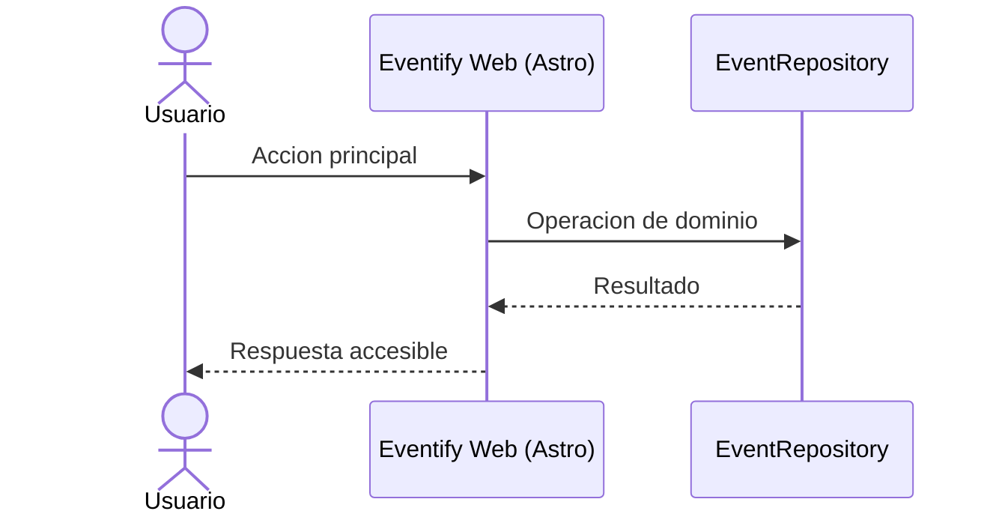

# Plan de Proyecto: [Nombre del Proyecto]

- **Slug:** `<slug-del-proyecto>`
- **Estado:** En planificación | Aprobado | En progreso | Verificado
- **Fecha:** YYYY-MM-DD

---

## 1. Validación del Gate de Negocio (`AGENTS.md`)

- **Alineamiento con Misión (conectar usuarios con eventos presenciales/remotos):**
  - ...
- **Alineamiento con Visión (plataforma #1 de eventos en LATAM):**
  - ...
- **Justificación de valor:** ¿Qué problema concreto resuelve y qué pasa si no lo hacemos?
  - ...

---

## 2. Impacto por Área de Eventify

| Área | Rol / Beneficio | Entregables o Dependencias |
| :--- | :--- | :--- |
| **Marketing** | | |
| **Contabilidad** | | |
| **Ops** | | |
| **Desarrollo** | | |

---

## 3. Evaluación de *Ilities*

- **Security:** ...
- **Usability:** ...
- **Portability:** ...

---

## 4. Estimación de Esfuerzo y Tiempo

- **Esfuerzo total estimado:** `X horas` (Talla: `S / M / L`)
- **Duración estimada / Fases:**
  - **Fase 1:** ...
  - **Fase 2:** ...
- **Ruta crítica y dependencias:** ...

---

## 5. Diseño y Diagrama de Flujo / Secuencia

---

## 6. Impacto en Arquitectura y C4 Model

- [ ] `docs/architecture/overview.md` revisado / actualizado
- [ ] `docs/architecture/c4-model.md` revisado / actualizado
