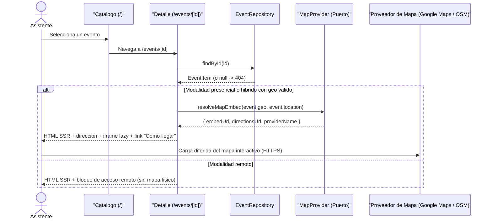

# Plan de Proyecto: Página de Detalle de Evento con Mapa de Ubicación

- **Slug:** `event-detail-maps`
- **Estado:** En planificación
- **Fecha:** 2026-11-19

---

## 1. Validación del Gate de Negocio (`AGENTS.md`)

**Resultado del Gate:** **APROBADO (con alcance arquitectónico desacoplado)**

- **Alineamiento con Misión (conectar usuarios con eventos presenciales/remotos):**
  - Reduce la fricción para asistir a eventos **presenciales** e **híbridos** al mostrar la ubicación exacta del venue en un mapa interactivo y ofrecer acceso directo a indicaciones ("Cómo llegar").
  - Refuerza la claridad en eventos **remotos** al omitir el mapa físico y presentar en su lugar un bloque dedicado de acceso virtual y zona horaria LATAM.
- **Alineamiento con Visión (plataforma #1 de eventos en LATAM):**
  - Introduce páginas individuales por evento (`/events/[id]`) indexables y compartibles, elevando la calidad de descubrimiento, SEO local por ciudad/país y confianza del asistente frente a competidores regionales.
- **Justificación de valor:**
  - Actualmente Eventify solo cuenta con un listado en `/` sin vista de detalle ni referencia geográfica visual. Sin esta iniciativa, los asistentes no pueden verificar dónde se realiza un evento presencial/híbrido ni abrir rutas en su dispositivo, aumentando el abandono antes del registro y los tickets de soporte para Ops.
- **Coherencia con el Stack:**
  - 100% compatible con Astro SSR, Tailwind CSS v4, TypeScript estricto, In-Memory Database y `pnpm`. **No requiere instalar dependencias npm ni SDKs pesados de terceros.**

---

## 2. Impacto por Área de Eventify

| Área | Rol / Beneficio | Entregables o Dependencias |
| :--- | :--- | :--- |
| **Marketing** | Páginas de detalle compartibles (`/events/[id]`) para campañas, mejor SEO local (ciudad/país/venue) y mayor tasa de conversión en eventos presenciales e híbridos. | Validar copy de ubicación, metadatos `<title>`/`<meta name="description">` por evento y CTA de cómo llegar. |
| **Contabilidad** | Control de costos de terceros: evita el costo variable de **Google Maps JavaScript API** (~USD $7 / 1,000 cargas tras crédito) usando **Google Maps Embed API** (gratuita en modo `place`) + fallback gratuito **OpenStreetMap** cuando no haya API key configurada. | Aprobar política de costos $0 en MVP (Embed API / fallback OSM) y definir alerta de presupuesto en Google Cloud si a futuro se habilitan APIs de pago (Routes/Places). |
| **Ops** | Menos consultas de soporte sobre ubicación del venue; separación clara entre logística presencial/híbrida (dirección + mapa + aforo) y logística remota (acceso streaming + zona horaria). | Proveer/validar dirección exacta y coordenadas (`latitude`, `longitude`) para los venues en el alta de eventos. |
| **Desarrollo** | Implementa `/events/[id]`, extiende el dominio con `GeoCoordinates` y crea un puerto portable `MapProvider` con adaptadores intercambiables (Google Maps / OpenStreetMap) sin lock-in. | Contratos de dominio, adaptadores de mapas, componente accesible `EventLocationMap.astro`, página `/events/[id]` y verificación con `chrome-verifier`. |

---

## 3. Reglas de Negocio por Modalidad

| Modalidad (`EventModality`) | ¿Muestra Mapa? | Experiencia en `/events/[id]` |
| :--- | :--- | :--- |
| `presencial` | **Sí** (si tiene coordenadas válidas) | Dirección estructurada + mapa interactivo + enlaces "Abrir en Google Maps" / "Cómo llegar". |
| `hibrido` | **Sí** (si tiene coordenadas válidas) | Bloque presencial (dirección + mapa + indicaciones) **y** bloque de acceso remoto (streaming + zona horaria). |
| `remoto` | **No** | Sin mapa físico. Muestra bloque de experiencia 100% remota (plataforma/sala, zona horaria LATAM y recomendaciones de conexión). |
| `presencial`/`hibrido` sin coordenadas | **Fallback seguro** | Muestra dirección textual + enlace de búsqueda segura en mapa externo, sin renderizar un `<iframe>` roto. |

---

## 4. Evaluación de *Ilities*

### Security (Seguridad)
- **Validación estricta de datos geográficos:** Validar en dominio que `latitude` esté en `[-90, 90]`, `longitude` en `[-180, 180]` (`Number.isFinite`) y sanitizar/codificar con `encodeURIComponent` cualquier etiqueta o dirección antes de construir URLs.
- **Construcción segura de URLs (allowlist):** Los adaptadores de mapas deben construir URLs con `new URL(...)` restringiendo el protocolo a `https:` y hosts permitidos (`www.google.com`, `www.openstreetmap.org`).
- **Aislamiento de `<iframe>`:** Usar `sandbox="allow-scripts allow-same-origin allow-popups"`, `referrerpolicy="no-referrer-when-downgrade"` y `loading="lazy"`. Nunca inyectar HTML crudo (`set:html`).
- **Gestión de API Key:** Si se usa Google Maps Embed API, leerla únicamente desde variable de entorno (`PUBLIC_GOOGLE_MAPS_EMBED_KEY`, documentada en `.env.example`), nunca hardcodeada en el código, y restringirla por *HTTP Referrer* en Google Cloud Console.
- **Frontera de ruta `/events/[id]`:** Validar el parámetro `id` y devolver respuesta HTTP `404` semántica si el evento no existe.

### Usability (Usabilidad)
- **Accesibilidad (WCAG 2.1 AA):**
  - El `<iframe>` incluye `title` descriptivo (ej. `"Mapa interactivo de ubicación: Centro Cultural Konex, Buenos Aires"`).
  - Siempre ofrece alternativa textual completa (dirección legible, ciudad, país) y enlace externo con foco visible y `rel="noopener noreferrer"` para usuarios de teclado o lectores de pantalla.
- **Rendimiento y Core Web Vitals:**
  - Contenedor del mapa con `aspect-video` (o altura reservada explícita) para garantizar **CLS = 0**.
  - Carga diferida (`loading="lazy"`) para no competir con el **LCP** del encabezado del evento.
  - Navegación fluida desde las tarjetas en `/` hacia `/events/[id]` y breadcrumb/enlace de retorno claro.

### Portability (Portabilidad)
- **Cero lock-in con Google Maps:** Se define un puerto de dominio `MapProvider` (`apps/web/src/domain/maps/map-provider.ts`) que abstrae la generación de URLs de embed e indicaciones.
- **Adaptadores intercambiables:**
  - `GoogleMapsEmbedProvider` (`apps/web/src/infrastructure/maps/google-maps.provider.ts`): usa Google Maps Embed API cuando `PUBLIC_GOOGLE_MAPS_EMBED_KEY` está configurada (y siempre ofrece deep-link a Google Maps).
  - `OpenStreetMapEmbedProvider` (`apps/web/src/infrastructure/maps/openstreetmap.provider.ts`): fallback nativo sin API key ni tracking para desarrollo local, CI o contingencia de proveedor.
- **Estándares web nativos:** Basado en `<iframe>`, HTML semántico y Web API `URL`, sin librerías propietarias en `package.json`.

---

## 5. Estimación de Esfuerzo y Tiempo

- **Esfuerzo total estimado:** `10 horas` (Talla: **M**)
- **Duración estimada / Fases:** 2 días de desarrollo + verificación (1 persona)
  - **Fase 1 — Dominio y Adaptadores de Mapas (`3 h`):** Extender `EventItem` con `geo?: GeoCoordinates`, actualizar `SEED_EVENTS`, crear puerto `MapProvider` + adaptadores Google Maps y OpenStreetMap con validaciones de seguridad.
  - **Fase 2 — Página de Detalle y UI Accesible (`5 h`):** Crear `EventLocationMap.astro`, página SSR `apps/web/src/pages/events/[id].astro` (incluyendo manejo `404` y diferenciación por modalidad) y enlazar tarjetas desde `apps/web/src/pages/index.astro`.
  - **Fase 3 — Documentación de Entorno y Verificación Integral (`2 h`):** Configurar `.env.example`, validar `pnpm astro check` / `pnpm build` y ejecutar auditoría completa en navegador real con `chrome-verifier`.
- **Ruta crítica y dependencias:** `T-01 (Dominio Geo)` → `T-02 (Puerto y Adaptadores MapProvider)` → `T-03 (Componente EventLocationMap)` → `T-04 (Página /events/[id] y enlaces desde /)` → `T-06 (Verificación Chrome DevTools)`.

### Riesgos y Mitigaciones

| Riesgo | *Ility* / Área | Probabilidad | Mitigación |
| :--- | :--- | :--- | :--- |
| Falta de API Key de Google Maps en local o demo | Portability / Ops | Alta | Fallback automático a `OpenStreetMapEmbedProvider` + enlace directo "Abrir en Google Maps" siempre funcional. |
| Costos inesperados en Google Cloud | Contabilidad | Media | Usar únicamente Embed API (gratuita) o enlaces directos; prohibir SDK JS de pago sin aprobación previa de Contabilidad. |
| Degradación de LCP/CLS por carga del `<iframe>` | Usability | Media | Reservar espacio con `aspect-video` (CLS = 0) y aplicar `loading="lazy"`. |
| Inyección de URLs maliciosas en coordenadas/dirección | Security | Baja | Validación estricta de rangos numéricos y construcción mediante `new URL()` con allowlist de hosts HTTPS. |

---

## 6. Diseño y Diagrama de Flujo / Secuencia

---

## 7. Decisiones Clave a Validar Antes de Implementar

1. **Estrategia de clave de Google Maps:** ¿Se cuenta ya con una `PUBLIC_GOOGLE_MAPS_EMBED_KEY` restringida por dominio para usar **Google Maps Embed API** en producción, o iniciamos con el adaptador **Google Maps (si hay key) + fallback automático a OpenStreetMap** para que funcione de inmediato en local/demo sin bloqueos? *(Recomendado: estrategia híbrida con fallback automático).*
2. **Estructura de URL del detalle:** Usar `/events/[id]` aprovechando el `EventRepository.findById(id)` existente (ej. `/events/evt-nerdearla-latam`).
3. **Interacción inicial del mapa:** Cargar el `<iframe>` directamente con `loading="lazy"` (más directo para el usuario) vs patrón *facade* ("Ver mapa interactivo" al clic para cero requests de terceros hasta interacción). *(Recomendado: `loading="lazy"` con `aspect-video` en MVP; evolucionable a facade si Marketing/Security requieren consentimiento explícito de terceros).*

---

## 8. Impacto en Arquitectura y C4 Model

- [x] `docs/architecture/overview.md` revisado y actualizado con el puerto `MapProvider` y la capa de adaptadores de mapas.
- [x] `docs/architecture/c4-model.md` revisado y actualizado en Nivel 1 (Proveedor de Mapas externo), Nivel 2 (Contenedor de Dominio/UI) y Nivel 3 (Página `/events/[id]`, `EventLocationMap.astro` y `MapProvider`).
