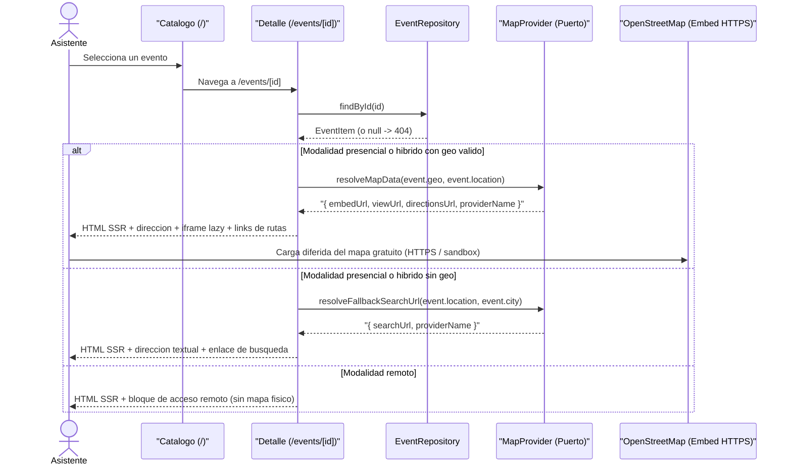

# Plan de Proyecto: Vista de Detalle de Evento con Mapa Gratuito (OpenStreetMap)

- **Slug:** `event-detail-maps`
- **Estado:** En planificación (actualizado a solución 100% gratuita sin API key)
- **Fecha:** 2026-11-20

---

## 1. Validación del Gate de Negocio (`AGENTS.md`)

**Resultado del Gate:** **APROBADO**

- **Alineamiento con Misión (conectar usuarios con eventos presenciales/remotos):**
  - Reduce la fricción para asistir a eventos **presenciales** e **híbridos** al mostrar la ubicación exacta del venue en un mapa interactivo gratuito y ofrecer acceso directo a indicaciones ("Cómo llegar").
  - Refuerza la claridad en eventos **remotos** al omitir el mapa físico y presentar en su lugar un bloque dedicado de acceso virtual y zona horaria LATAM.
- **Alineamiento con Visión (plataforma #1 de eventos en LATAM):**
  - Introduce páginas individuales por evento (`/events/[id]`) indexables y compartibles, elevando la calidad de descubrimiento, SEO local por ciudad/país y confianza del asistente en toda la región sin depender de proveedores de mapas de pago.
- **Justificación de valor:**
  - Actualmente Eventify solo cuenta con un listado en `/` (`apps/web/src/pages/index.astro`) sin vista de detalle ni referencia geográfica visual. Sin esta iniciativa, los asistentes no pueden verificar dónde se realiza un evento presencial/híbrido ni abrir indicaciones, aumentando el abandono y las consultas de soporte a Ops.
- **Coherencia con el Stack:**
  - 100% compatible con Astro SSR (`@astrojs/node`), Tailwind CSS v4, TypeScript estricto, In-Memory Database y `pnpm`. **Cero dependencias npm nuevas y cero API keys o cuentas de nube requeridas.**

---

## 2. Evaluación de Opciones de Mapa Gratuito

Se evaluaron tres alternativas gratuitas frente a las 3 *ilities* (**Security**, **Usability**, **Portability**) y el presupuesto $0:

| Opción | Costo / Licencias | Security (CSP y aislamiento) | Usability y CWV (LCP / INP / CLS) | Portability y Mantenimiento | Veredicto |
| :--- | :--- | :--- | :--- | :--- | :--- |
| **A. OpenStreetMap Embed (`<iframe>` nativo) + Deep-links abiertos** | **$0 perpetuo**, sin API key ni tarjeta | **Alta:** aislado en `<iframe>` con `sandbox`, `referrerpolicy="no-referrer"`, allowlist HTTPS (`www.openstreetmap.org`) y `frame-src` acotado; cero JS de terceros en el DOM principal | **Excelente:** **0 KB JS** en cliente, `loading="lazy"` (no compite con LCP) y `aspect-video` (**CLS = 0**); siempre acompañado de dirección textual y enlace externo accesible | **Máxima:** estándar HTML nativo detrás del puerto `MapProvider`; cero dependencias npm | **RECOMENDADA (MVP)** |
| **B. Leaflet + Tiles públicos de OSM** | $0 inicial, pero sujeto a *OSM Tile Usage Policy* (prohíbe alto tráfico comercial sin servidor propio de tiles) | **Media:** ejecuta JS/CSS de terceros en el documento principal y amplía CSP (`script-src`, `img-src`) | **Media:** agrega ~40 KB+ de JS/CSS, hidratación cliente y mayor complejidad para navegación por teclado | **Media-Alta:** código abierto, pero acopla la UI a `leaflet` y exige hosting de tiles al escalar en LATAM | Descartada para MVP |
| **C. MapLibre GL JS + Vector Tiles (OpenFreeMap / Protomaps)** | $0 moderado; requiere infraestructura propia al escalar | **Media:** requiere WebGL y worker/script externo | **Baja para MVP:** bundle pesado (~200 KB+ gzipped), sobrecosto innecesario en móviles de gama media/baja en LATAM para un solo marcador | **Media:** complejidad operativa innecesaria para un mapa de ubicación de venue | Descartada para MVP |

**Decisión arquitectónica:** Adoptar **Opción A (`OpenStreetMapEmbedProvider`)** encapsulada detrás del puerto de dominio **`MapProvider`** (`apps/web/src/domain/maps/map-provider.ts`). Si en el futuro Eventify necesita mapas vectoriales interactivos avanzados, bastará con crear un nuevo adaptador en `apps/web/src/infrastructure/maps/` sin modificar la página `/events/[id]` ni el componente `EventLocationMap.astro`.

---

## 3. Impacto por Área de Eventify

| Área | Rol / Beneficio | Entregables o Dependencias |
| :--- | :--- | :--- |
| **Marketing** | Páginas de detalle compartibles (`/events/[id]`) para campañas, SEO local mejorado (`<title>` y `<meta name="description">` dinámicos por evento/ciudad) y mayor conversión en eventos presenciales e híbridos. | Validar copy de ubicación, metadatos por evento y textos de CTA ("Ver mapa más grande" / "Cómo llegar"). |
| **Contabilidad** | **Costo operativo $0 garantizado** en mapas: elimina por completo riesgo de facturación variable, cuotas o tarjetas en Google Cloud / Mapbox gracias a OpenStreetMap. | Aprobar política de mapas abiertos $0 sin API keys de pago para la plataforma base. |
| **Ops** | Menos tickets de soporte sobre cómo llegar al venue; diferenciación clara entre logística presencial/híbrida (dirección + mapa + aforo) y logística remota (acceso streaming + zona horaria LATAM). | Proveer y validar dirección exacta y coordenadas (`latitude`, `longitude`) para los venues en el alta de eventos. |
| **Desarrollo** | Implementa `/events/[id]`, extiende el dominio con `EventGeoLocation` y construye el puerto portable `MapProvider` + `OpenStreetMapEmbedProvider` con cero dependencias npm nuevas. | Contratos de dominio, adaptador OpenStreetMap, componente `EventLocationMap.astro`, página `/events/[id]`, enlaces desde `/` y verificación con `chrome-verifier`. |

---

## 4. Reglas de Negocio por Modalidad

| Modalidad (`EventModality`) | ¿Muestra Mapa? | Experiencia en `/events/[id]` |
| :--- | :--- | :--- |
| `presencial` | **Sí** (si tiene coordenadas válidas) | Dirección estructurada + mapa interactivo OpenStreetMap + enlaces "Ver en OpenStreetMap" y "Cómo llegar". |
| `hibrido` | **Sí** (si tiene coordenadas válidas) | Bloque presencial (dirección + mapa OpenStreetMap + indicaciones) **y** bloque de acceso remoto (streaming + zona horaria LATAM). |
| `remoto` | **No** | Sin mapa físico. Muestra bloque de experiencia 100% remota (plataforma/sala, zona horaria LATAM y recomendaciones de conexión). |
| `presencial`/`hibrido` sin coordenadas | **Fallback seguro** | Muestra dirección textual + enlace de búsqueda segura en OpenStreetMap (`https://www.openstreetmap.org/search?query=...`), sin renderizar un `<iframe>` roto. |

---

## 5. Evaluación de *Ilities*

### Security (Seguridad)
- **Validación estricta de coordenadas en dominio:** Helper puro `isValidGeoCoordinates` que verifica `Number.isFinite`, `latitude` en `[-90, 90]` y `longitude` en `[-180, 180]`, acotando el *bounding box* (`bbox`) a rangos válidos.
- **Construcción segura de URLs (allowlist):** `OpenStreetMapEmbedProvider` construye URLs exclusivamente con `new URL(...)`, protocolo `https:` y host permitido `www.openstreetmap.org`, codificando cualquier dirección con `URLSearchParams`.
- **Aislamiento de `<iframe>`:** Usar `sandbox="allow-scripts allow-same-origin"` (sin `allow-forms` ni `allow-top-navigation`), `referrerpolicy="no-referrer"` y `loading="lazy"`. Nunca inyectar HTML crudo (`set:html`). Preparado para CSP estricta (`frame-src https://www.openstreetmap.org`).
- **Cero secretos o API keys:** Al no requerir API key, se elimina toda superficie de exposición de credenciales en cliente o repositorio.
- **Frontera de ruta `/events/[id]`:** Validar el parámetro `id` y devolver HTTP `404` semántico y seguro si el evento no existe.

### Usability (Usabilidad)
- **Accesibilidad (WCAG 2.1 AA):**
  - El `<iframe>` incluye `title` descriptivo (ej. `"Mapa interactivo de ubicación: Centro Cultural Konex, Buenos Aires"`).
  - Siempre ofrece alternativa textual completa (dirección legible, ciudad, país) y enlaces externos con foco visible y `rel="noopener noreferrer"` para usuarios de teclado y lectores de pantalla.
  - Atribución visible a colaboradores de OpenStreetMap (cumplimiento de licencia ODbL y transparencia para el usuario).
- **Rendimiento y Core Web Vitals:**
  - Contenedor del mapa con `aspect-video` (altura reservada) para garantizar **CLS = 0**.
  - Carga diferida (`loading="lazy"`) para no competir con el **LCP** del encabezado del evento.
  - **0 KB de JavaScript cliente** adicional para mantener **INP** óptimo en dispositivos móviles de LATAM.
  - Navegación clara desde cada tarjeta en `/` hacia `/events/[id]` y breadcrumb/enlace de retorno "Volver a eventos".

### Portability (Portabilidad)
- **Cero lock-in de proveedor:** El puerto `MapProvider` (`apps/web/src/domain/maps/map-provider.ts`) desacopla los componentes Astro de OpenStreetMap. Cualquier cambio futuro de proveedor solo requiere un nuevo adaptador en `apps/web/src/infrastructure/maps/`.
- **Estándares web nativos:** Basado en `<iframe>`, HTML5 semántico, CSS moderno y Web API `URL`, sin librerías propietarias ni SDKs en `package.json`.
- **Compatible con cualquier entorno:** Funciona idénticamente en desarrollo local, CI, staging y producción sin variables de entorno ni secretos externos.

---

## 6. Estimación de Esfuerzo y Tiempo

- **Esfuerzo total estimado:** `9 horas` (Talla: **M**)
- **Duración estimada / Fases:** 1.5 días de desarrollo + verificación (1 persona)
  - **Fase 1 — Dominio y Adaptador OpenStreetMap (`3 h`):** Extender `EventItem` con `geo?: EventGeoLocation`, poblar coordenadas verificadas en `SEED_EVENTS`, crear puerto `MapProvider` y adaptador `OpenStreetMapEmbedProvider` con validaciones de seguridad.
  - **Fase 2 — Componente de Mapa y Página de Detalle (`4.5 h`):** Consultar `modern-web-guidance`, crear `EventLocationMap.astro`, implementar página SSR `apps/web/src/pages/events/[id].astro` (con manejo `404` y reglas por modalidad), enlazar tarjetas desde `apps/web/src/pages/index.astro` y validar `astro check` + `build`.
  - **Fase 3 — Verificación Integral (`1.5 h`):** Ejecutar auditoría en navegador real (desktop y mobile) con `chrome-verifier` validando las 3 *ilities*.
- **Ruta crítica y dependencias:** `T-01 (Dominio Geo)` → `T-02 (Puerto MapProvider + OpenStreetMap)` → `T-03 (Componente EventLocationMap)` → `T-04 (Página /events/[id] y enlaces desde /)` → `T-05 (Check y Build)` → `T-06 (Verificación Chrome DevTools)`.

### Riesgos y Mitigaciones

| Riesgo | *Ility* / Área | Probabilidad | Mitigación |
| :--- | :--- | :--- | :--- |
| Caída temporal o bloqueo de red hacia `openstreetmap.org` en cliente | Usability / Ops | Baja | Mostrar siempre la dirección textual completa y enlaces externos alternativos; el detalle del evento sigue siendo 100% utilizable sin el `<iframe>`. |
| Degradación de LCP/CLS por carga del `<iframe>` | Usability | Media | Reservar espacio con `aspect-video` (**CLS = 0**) y aplicar `loading="lazy"` para priorizar el LCP del hero del evento. |
| Coordenadas faltantes o inválidas al crear eventos | Security / Ops | Media | Validar con `isValidGeoCoordinates` en dominio; si falta o es inválida, renderizar fallback textual + enlace de búsqueda segura sin `<iframe>`. |
| Tráfico muy alto a futuro que demande estilos personalizados o mapas vectoriales | Portability / Desarrollo | Baja | Puerto `MapProvider` desacoplado permite migrar a tiles propios (Protomaps/MapLibre) u otro proveedor sin tocar las vistas Astro. |

---

## 7. Diseño y Diagrama de Flujo / Secuencia

---

## 8. Impacto en Arquitectura y C4 Model

- [x] `docs/architecture/overview.md` revisado y actualizado con el puerto `MapProvider` y el adaptador gratuito `OpenStreetMapEmbedProvider`.
- [x] `docs/architecture/c4-model.md` revisado y actualizado en Nivel 1 (OpenStreetMap externo), Nivel 2 (Contenedor de Dominio/UI) y Nivel 3 (Página `/events/[id]`, `EventLocationMap.astro`, puerto `MapProvider` y adaptador `openstreetmap.provider.ts`).
