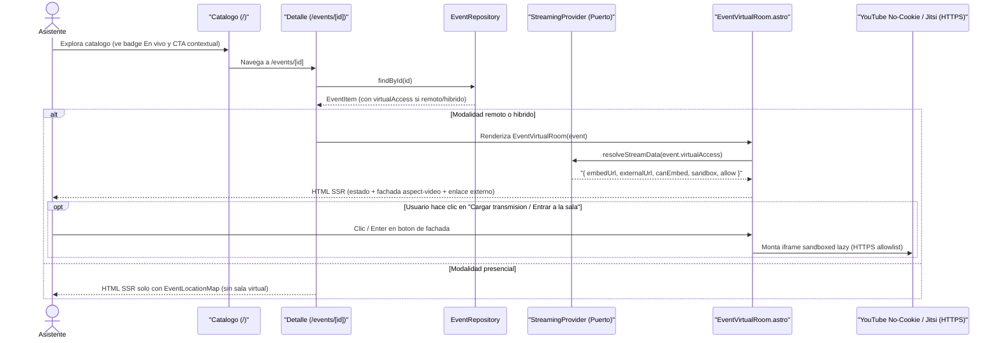

# Plan de Proyecto: Eventos Virtuales — Sala y Transmisión Embebida

- **Slug:** `virtual-events-streaming`
- **Estado:** Planificado
- **Fecha:** 2026-11-20

---

## 1. Validación del Gate de Negocio (`AGENTS.md`)

**Resultado del Gate:** **APROBADO**

- **Alineamiento con Misión (conectar usuarios con eventos presenciales/remotos):**
  - Completa la promesa de valor para eventos **remotos** e **híbridos** al ofrecer una sala virtual y transmisión embebida directamente en `/events/[id]`, con estado de transmisión en tiempo real (`En vivo`, `Próximo`, `Finalizado`), acceso seguro y enlace externo de respaldo.
  - Equilibra la experiencia remota frente a la experiencia presencial ya cubierta por `event-detail-maps` (OpenStreetMap).
- **Alineamiento con Visión (plataforma #1 de eventos en LATAM):**
  - Eleva la calidad percibida de los eventos en línea en toda la región con una experiencia liviana (pensada para conexiones móviles de LATAM), clara en zonas horarias regionales y sin fricción de registro ni dependencias propietarias de pago.
- **Justificación de valor:**
  - Actualmente los eventos `remoto` e `hibrido` solo muestran una caja de texto genérica dentro de `EventLocationMap.astro`, sin indicar si el evento está en vivo, sin reproductor/sala embebida y sin enlace accionable de ingreso. Sin esta iniciativa, los asistentes abandonan la plataforma buscando el enlace de streaming y aumenta la carga de soporte para **Ops** minutos antes de iniciar cada evento.
- **Coherencia con el Stack:**
  - 100% compatible con Astro SSR (`@astrojs/node`), Tailwind CSS v4, TypeScript estricto, In-Memory Database y `pnpm`. **Cero dependencias npm nuevas y cero API keys o servicios de streaming de pago.**

---

## 2. Evaluación de Opciones de Streaming Gratuito y Portable

Se evaluaron tres enfoques frente a las 3 *ilities* (**Security**, **Usability**, **Portability**) y costo operativo $0:

| Opción | Costo / Licencias | Security (CSP y aislamiento) | Usability y CWV (LCP / INP / CLS) | Portability y Mantenimiento | Veredicto |
| :--- | :--- | :--- | :--- | :--- | :--- |
| **A. Puerto `StreamingProvider` + Embeds abiertos con allowlist (YouTube No-Cookie / Jitsi Meet) + Fallback HTTPS** | **$0 perpetuo**, sin API key ni tarjeta | **Alta:** allowlist estricta HTTPS (`www.youtube-nocookie.com`, `meet.jit.si`), validación de IDs por regex, `<iframe>` sandboxed con `referrerpolicy="no-referrer"`, cero `set:html` | **Excelente:** fachada ligera bajo demanda (clic para cargar `<iframe>`) + `aspect-video` (**CLS = 0**), no compite con LCP y mantiene INP óptimo; siempre con enlace externo alternativo | **Máxima:** estándar HTML nativo detrás del puerto `StreamingProvider`; cero dependencias npm | **RECOMENDADA (MVP)** |
| **B. SDK propietario embebido (Zoom Web SDK / Agora / Daily)** | Costo variable por minuto/asistente y API keys obligatorias | **Media:** ejecuta scripts pesados de terceros en el documento principal y requiere tokens de servidor | **Media-Baja:** bundles de >300 KB que penalizan LCP/INP en móviles de LATAM | **Baja:** alto vendor lock-in y mantenimiento de SDKs | Descartada |
| **C. Solo enlace externo sin experiencia de sala** | $0 | **Alta** | **Baja:** saca al usuario de Eventify y no diferencia estados (`En vivo`, `Próximo`, `Finalizado`) ni ofrece experiencia integrada | **Alta** | Insuficiente para la Misión/Visión |

**Decisión arquitectónica:** Adoptar **Opción A (`OpenStreamingEmbedProvider`)** detrás del puerto de dominio **`StreamingProvider`** (`apps/web/src/domain/streaming/streaming-provider.ts`), replicando exactamente el patrón de portabilidad establecido con `MapProvider`. Si en el futuro Eventify incorpora Mux, Vimeo, Twitch o infraestructura WebRTC propia, bastará con implementar un nuevo adaptador en `apps/web/src/infrastructure/streaming/` sin modificar `EventVirtualRoom.astro` ni `/events/[id]`.

---

## 3. Impacto por Área de Eventify

| Área | Rol / Beneficio | Entregables o Dependencias |
| :--- | :--- | :--- |
| **Marketing** | Incrementa conversión y tiempo de permanencia en `/events/[id]`; agrega badge contextual `"En vivo"` y CTA diferenciados en `/` (`"Ver detalle y sala virtual →"`, `"Ver detalle, mapa y sala →"`) para destacar eventos activos en LATAM. | Validar copy de estados (`En vivo`, `Próximo`, `Finalizado`) y mensajes de sala de espera. |
| **Contabilidad** | **Costo operativo $0 garantizado** en streaming base: cero cargos por transcodificación, ancho de banda o API keys mediante YouTube No-Cookie, Jitsi Meet y enlaces externos validados. | Aprobar política de streaming abierto $0 para la capa base de la plataforma. |
| **Ops** | Reduce tickets de soporte previos y durante el evento al centralizar estado de transmisión, plataforma, zona horaria LATAM, notas de acceso y enlace alternativo de respaldo en un único bloque claro. | Definir y mantener actualizados `status`, `platform`, `roomOrVideoId`, `externalUrl` y `accessNotes` al operar eventos remotos/híbridos. |
| **Desarrollo** | Extiende `EventItem` con `virtualAccess?: EventVirtualAccess`, implementa puerto `StreamingProvider` + adaptador `OpenStreamingEmbedProvider`, crea `EventVirtualRoom.astro` y separa responsabilidades respecto a `EventLocationMap.astro`. | Contratos de dominio, validadores puros, adaptador, componentes UI, actualización de `SEED_EVENTS` y verificación con `chrome-verifier`. |

---

## 4. Reglas de Negocio por Modalidad y Estado de Transmisión

### Por Modalidad (`EventModality`)

| Modalidad | ¿Renderiza `EventVirtualRoom.astro`? | ¿Renderiza `EventLocationMap.astro`? | Experiencia en `/events/[id]` |
| :--- | :--- | :--- | :--- |
| `remoto` | **Sí** | **No** | Sala virtual completa como bloque principal (estado, transmisión/fachada segura, zona horaria LATAM, notas de acceso y enlace externo). |
| `hibrido` | **Sí** | **Sí** (solo sede física) | Muestra `EventVirtualRoom.astro` (experiencia remota) **y** `EventLocationMap.astro` (solo sede presencial + mapa OpenStreetMap), sin duplicar el bloque de acceso remoto. |
| `presencial` | **No** | **Sí** | Sin sala virtual; muestra únicamente `EventLocationMap.astro` con sede física y mapa OpenStreetMap. |

### Por Estado de Transmisión (`EventStreamStatus`)

| Estado | Indicador Visual / Accesible | Comportamiento del Reproductor / Sala |
| :--- | :--- | :--- |
| `en-vivo` | Badge `"En vivo"` con contraste WCAG AA y texto explícito (no solo color) | Si `canEmbed` es `true`, muestra fachada ligera interactiva (`aspect-video`, botón `"Cargar transmisión"` / `"Entrar a la sala"`) que carga bajo demanda el `<iframe>` seguro + enlace `"Abrir en [Plataforma]"`. Si no es embebible (`external`), muestra CTA destacado hacia `externalUrl`. |
| `proximo` | Badge `"Próximo"` | Sala de espera previa: destaca fecha/hora, zona horaria LATAM, notas de preparación y enlace anticipado a la plataforma (sin cargar un `<iframe>` innecesario antes del inicio). |
| `finalizado` | Badge `"Finalizado"` | Indica que la transmisión en vivo concluyó; si es `youtube` embebible permite reproducir la grabación bajo demanda mediante la misma fachada segura, o muestra enlace externo de cierre/recursos. |
| Sin `virtualAccess` válido | Fallback informativo | Muestra tarjeta limpia con plataforma textual (`event.location`), zona horaria LATAM y recomendaciones de conexión, sin renderizar `<iframe>` roto. |

---

## 5. Evaluación de *Ilities*

### Security (Seguridad)
- **Validadores puros en dominio:** `isValidStreamStatus`, `isValidStreamPlatform`, `isSafeHttpsUrl` e `isValidVirtualAccess` en `apps/web/src/domain/events/event.types.ts`. Rechazan esquemas peligrosos (`javascript:`, `data:`, `http:` inseguro) y caracteres fuera de formato.
- **Allowlist estricta en adaptador:** `OpenStreamingEmbedProvider` construye URLs exclusivamente con `new URL(...)` y verifica protocolo `https:` y hosts permitidos:
  - `youtube`: `www.youtube-nocookie.com` con `roomOrVideoId` validado contra `/^[a-zA-Z0-9_-]{11}$/`.
  - `jitsi`: `meet.jit.si` con `roomOrVideoId` validado contra `/^[a-zA-Z0-9_-]{3,80}$/`.
  - `external`: `embedUrl: null` y `externalUrl` validado estrictamente con protocolo `https:`.
- **Aislamiento de `<iframe>`:** Atributos `sandbox` con mínimo privilegio (sin `allow-top-navigation`), `referrerpolicy="no-referrer"`, `loading="lazy"` y `allow` acotado por plataforma (p. ej. `autoplay; encrypted-media; picture-in-picture; fullscreen` para YouTube; `camera; microphone; fullscreen; display-capture` solo para Jitsi). Cero uso de `set:html`.
- **Enlaces externos seguros:** Todos los enlaces a plataformas externas usan `target="_blank" rel="noopener noreferrer"`.

### Usability (Usabilidad)
- **Accesibilidad (WCAG 2.1 AA):**
  - Landmarks semánticos (`<section aria-labelledby="...">`), encabezados jerárquicos y badges legibles por lectores de pantalla (texto + contraste mínimo 4.5:1, nunca solo un punto de color).
  - Fachada interactiva operable 100% por teclado (`<button type="button">` con foco visible) que al activarse inserta el `<iframe>` con `title` descriptivo (ej. `"Transmisión en vivo: Nerdearla Frontend Architecture Summit"`).
  - Siempre ofrece enlace externo alternativo y notas textuales de acceso/zona horaria LATAM.
- **Rendimiento y Core Web Vitals (CWV):**
  - **CLS = 0:** Contenedor del reproductor con `aspect-video` reservado desde el render SSR, tanto en la fachada como al montar el `<iframe>`.
  - **LCP protegido:** Al usar fachada ligera bajo demanda (clic del usuario para montar el `<iframe>`), la carga inicial de `/events/[id]` no descarga recursos pesados de YouTube/Jitsi ni bloquea el render principal.
  - **INP óptimo:** Script cliente mínimo (< 1 KB vanilla JS estándar, sin frameworks cliente) únicamente para hidratar el clic del botón de la fachada en el `<iframe>` ya validado desde SSR (`data-embed-url`, `data-iframe-title`, `data-iframe-sandbox`, `data-iframe-allow`).

### Portability (Portabilidad)
- **Desacoplamiento por puerto:** `StreamingProvider` (`apps/web/src/domain/streaming/streaming-provider.ts`) aísla `EventVirtualRoom.astro` de YouTube/Jitsi.
- **Estándares web nativos:** HTML5 semántico, `<iframe>`, `URL`, `data-*` y CSS moderno (Tailwind v4), con **0 dependencias npm nuevas**.
- **Sin acoplamiento de entorno:** Opera igual en local, CI y producción sin variables de entorno ni secretos.

---

## 6. Estimación de Esfuerzo y Tiempo

- **Esfuerzo total estimado:** `10 horas` (Talla: **M**)
- **Duración estimada / Fases:** 1.5 a 2 días (1 persona)
  - **Fase 1 — Dominio, Datos Semilla y Puerto `StreamingProvider` (`3.5 h`):** Extender `event.types.ts`, actualizar `in-memory-event.repository.ts` (`SEED_EVENTS`, `cloneEvent`, `create`) e implementar `StreamingProvider` + `OpenStreamingEmbedProvider`.
  - **Fase 2 — UI de Sala Virtual, Integración en `/events/[id]` y Catálogo `/` (`5 h`):** Consultar `modern-web-guidance`, construir `EventVirtualRoom.astro`, refactorizar `EventLocationMap.astro` para evitar duplicación en `hibrido`, integrar en `/events/[id].astro`, añadir mejoras contextuales en `index.astro` y validar `astro check` + `build`.
  - **Fase 3 — Verificación Integral (`1.5 h`):** Auditoría en navegador real (desktop y mobile) con `chrome-verifier` sobre los 3 estados (`en-vivo`, `proximo`, `finalizado`), modalidad `presencial` sin regresiones y las 3 *ilities*.
- **Ruta crítica y dependencias:** `T-01 (Dominio + Seed)` → `T-02 (Puerto StreamingProvider + Adaptador)` → `T-03 (EventVirtualRoom.astro)` → `T-04 (Integración /events/[id], refactor EventLocationMap y mejoras en /)` → `T-05 (Check y Build)` → `T-06 (Verificación Chrome DevTools)`.

### Riesgos y Mitigaciones

| Riesgo | *Ility* / Área | Probabilidad | Mitigación |
| :--- | :--- | :--- | :--- |
| Bloqueo corporativo o de red a `youtube-nocookie.com` / `meet.jit.si` en cliente | Usability / Ops | Media | Ofrecer siempre botón visible `"Abrir en plataforma externa"` + notas de acceso textuales; la página sigue siendo 100% funcional sin el `<iframe>`. |
| Inyección de URLs maliciosas (`javascript:`, hosts no autorizados) vía datos de evento | Security | Media | Validación doble: `isValidVirtualAccess` en dominio + allowlist estricta con `new URL` y regex de IDs en `OpenStreamingEmbedProvider`. |
| Regresión de LCP/INP/CLS por carga automática de reproductores de terceros | Usability | Alta (si se cargara eager) | Fachada ligera bajo demanda con `aspect-video` reservado (**CLS = 0**) y carga del `<iframe>` solo tras interacción explícita del usuario. |
| Duplicación de información remota en eventos `hibrido` entre mapa y sala virtual | Usability / Desarrollo | Media | Delegar toda experiencia remota a `EventVirtualRoom.astro` y acotar `EventLocationMap.astro` a ubicación física en `presencial` e `hibrido`. |

---

## 7. Diseño y Diagrama de Secuencia

---

## 8. Impacto en Arquitectura y C4 Model

- [x] `docs/architecture/overview.md` revisado y actualizado con el puerto `StreamingProvider`, el adaptador `OpenStreamingEmbedProvider` y el componente `EventVirtualRoom.astro`.
- [x] `docs/architecture/c4-model.md` revisado y actualizado en Nivel 1 (YouTube No-Cookie / Jitsi Meet), Nivel 2 (Contenedor de Dominio/UI), Nivel 3 (`EventVirtualRoom.astro`, `StreamingProvider`, `open-streaming.provider.ts`) y Nivel 4 (referencia viva de archivos).
